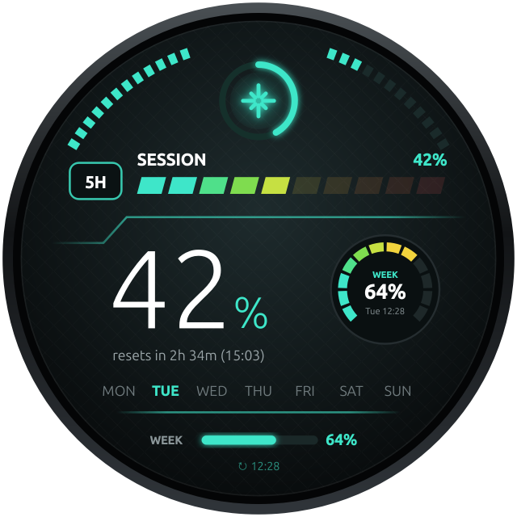

# Claude Usage Dial

A small desktop dial that shows how much of your **Claude** usage you've used: the current
**5-hour session** and **this week**. It's for Linux, Windows and macOS.

<p align="center"></p>

- **The big number** is your session %. The countdown under it shows when the session resets.
- **The week** is shown by the top arcs, the small ring and the bottom bar. The highlighted weekday
  is when the weekly limit resets.
- **Colours:** teal normally, amber from 75 %, red from 90 %. You can change both levels.
- **Tray / menu-bar icon:**  shows the session % in a ring.
  Hover over it to see both numbers.

> Not made by or affiliated with Anthropic.

## What you need

- **Claude Code** installed and **signed in with your Claude account** (Pro, Max, Team, …).
  The dial reads the login that Claude Code saves on your computer. You don't need an API key, and it
  doesn't work with API-key logins, because those have no usage limits to show.
  Get Claude Code at <https://claude.com/claude-code>, then run `claude` once in a terminal and sign in.

Nothing else needs to be installed. Everything the app needs is inside the download.

## Download and run

Get the file for your computer from the [**Releases**](../../releases/latest) page.

| System | File | First launch |
|---|---|---|
| **Linux** (x86-64) | `Claude-Usage-Dial-…-x86_64.AppImage` | Right-click it → *Properties* → allow *executing as a program*, then double-click it. Or in a terminal: `chmod +x Claude-Usage-Dial-*.AppImage && ./Claude-Usage-Dial-*.AppImage` |
| **Windows** 10/11 | `Claude-Usage-Dial-…-windows-x64.exe` | Double-click it. Windows SmartScreen may warn about an unknown publisher: click *More info* → *Run anyway*. |
| **macOS** (Apple silicon) | `Claude-Usage-Dial-…-macos-arm64.zip` | Unzip it and move *Claude Usage Dial* to Applications. The first time, **right-click → Open** (it isn't signed by Apple). macOS will ask to let it read the *Claude Code-credentials* Keychain item: choose *Always Allow*. |

The first time it runs, a **Setup** window opens. It checks that Claude Code is installed and signed in,
lets you test the connection, and has your preferences, including *Start when I log in*.
You can reopen it at any time from the tray menu (*Setup…*).

On **Windows and Linux**, the first run also adds **Claude Usage Dial** with its icon to the **Start menu /
app menu**, so you can open it from there next time. On Linux, keep the AppImage somewhere permanent (for
example `~/Applications`). If you move it later, just run it once from its new place and the menu entry follows.
You can turn this off in Setup (*Show in the Start menu / app menu*). On **macOS**, moving the app to
Applications already puts it in Launchpad.

Opening it again while it's already running just brings the dial to the front, so you won't get a second copy.

## Using the dial

- **Move:** drag the face. **Resize:** drag the outer rim (it stays round).
- **Hide:** double-click it or press Esc. Bring it back from the tray menu → *Show dial*.
- **Right-click** opens the menu. **R** refreshes now.
- The dial remembers its size and position. It stays on top of other windows unless you untick
  *Always on top*.
- It refreshes every 5 minutes. You can change that in Setup.

## Privacy and how it works

The app reads the login token that Claude Code stored on this computer:

- **Linux / Windows:** `~/.claude/.credentials.json` (or `$CLAUDE_CONFIG_DIR`)
- **macOS:** your login Keychain, item *Claude Code-credentials*

It uses that token for one thing only: asking `api.anthropic.com` for your usage numbers, the same
numbers `/usage` shows in Claude Code. The token is never stored anywhere else, never changed, and
never sent anywhere else. The app has no analytics and talks to no other server.

The token only lasts a few hours, and only Claude Code renews it, whenever you use it. So after a restart, or
a few hours without using Claude Code, the dial says *Login expired* and Setup shows an amber **!**. This
doesn't mean you're signed out. Open Claude Code once and the dial recovers on its next refresh by itself.

**Unofficial:** the usage service isn't publicly documented. If Anthropic changes it, the dial will
show an error until the app is updated.

## Known limits

- **Linux tray icon:** this needs desktop support. Ubuntu has it built in. On plain GNOME (Fedora, Debian),
  install the *AppIndicator and KStatusNotifierItem Support* extension. Without a tray, the dial is always shown
  and its right-click menu has everything.
- **Linux on Wayland:** apps can't set their own position or keep themselves on top there, so the remembered
  position and *Always on top* only work in X11/Xorg sessions.
- **macOS:** Apple silicon only for now. The Keychain sign-in path hasn't been tested on a real Mac yet.
  Reports welcome.

## Uninstall

1. In **Setup**, untick *Start when I log in* and *Show in the Start menu / app menu*, then choose *Quit*
   from the tray menu.
2. Delete the downloaded file (or the app from Applications).
3. Optionally, delete its settings folder:
   - Linux: `~/.config/claude-usage-dial`
   - Windows: `%APPDATA%\claude-usage-dial`
   - macOS: `~/Library/Application Support/claude-usage-dial`

## Building from source

```bash
python3 -m venv .venv
.venv/bin/pip install -r requirements.txt
.venv/bin/python -m claude_usage            # run it
.venv/bin/python -m pytest && .venv/bin/ruff check claude_usage tests
.venv/bin/pyinstaller packaging/claude-usage-dial.spec   # build for this OS
VERSION=0.1.0 packaging/build_appimage.sh                # Linux: wrap into an AppImage
```

Releases are built by GitHub Actions (`.github/workflows/release.yml`) when a `v*` tag is pushed.
On Linux, don't launch it from a VS Code *snap* terminal: the snap's environment breaks GUI apps
started from it.

## Licence

MIT (see [LICENSE](LICENSE)). The bundled Ubuntu font is under the Ubuntu Font Licence
([claude_usage/fonts/LICENCE.txt](claude_usage/fonts/LICENCE.txt)).
